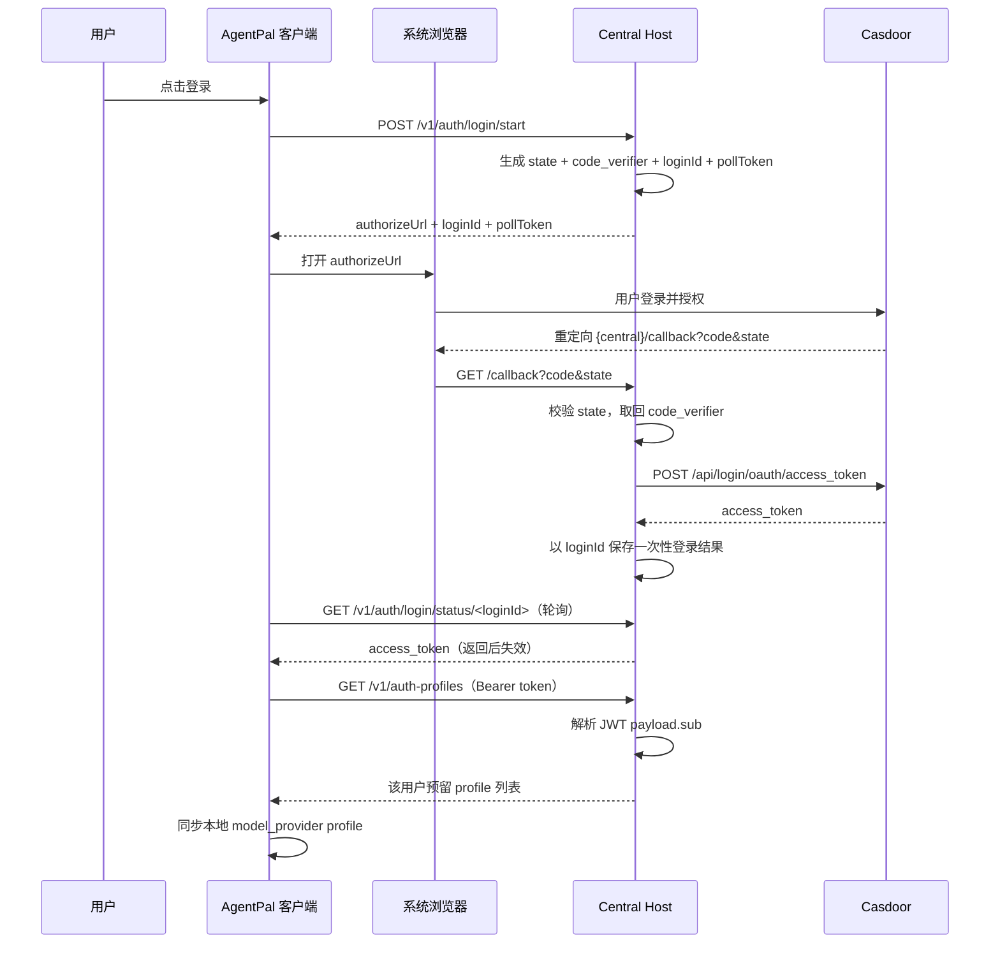
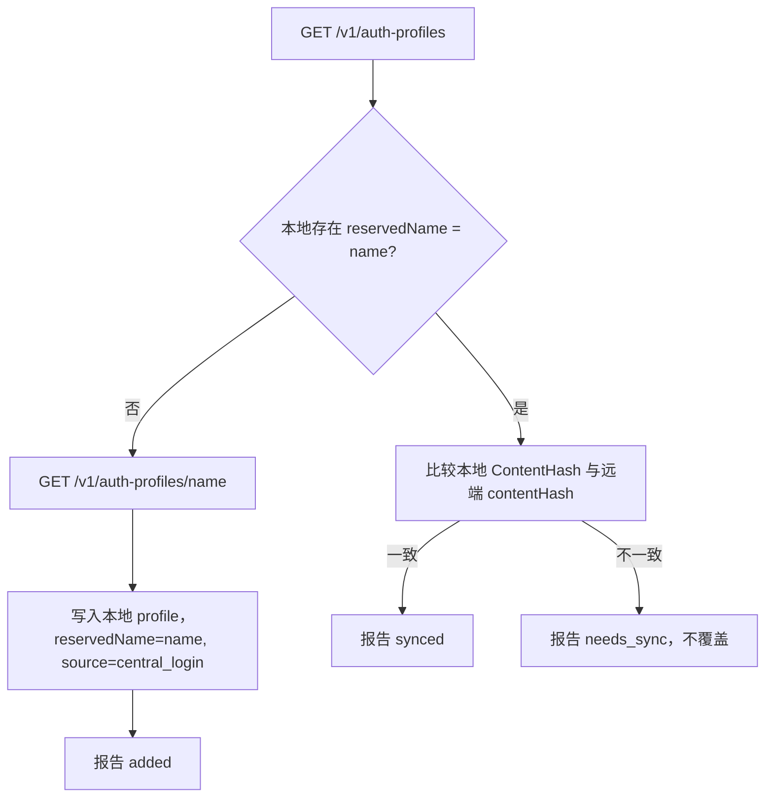

# AgentPal 中心登录与预留 Auth Profile 同步设计

## 1. 背景与目标

AgentPal 已有认证档案的本地管理和中心备份能力，但认证档案仍以本机为主，无法由中心为每个用户下发“预留名称”的 `model_provider` 配置。

本设计增加一条以中心账号为入口的链路：

1. 客户端跳转 Casdoor（`https://id.yprenew.com`）完成登录，获取 access token。
2. 客户端携带 token 向**已配置的 Central Host**拉取该用户被预留的 auth profile。
3. 客户端按预留的 `model_provider` 名称同步到本地认证档案：
   - 本地没有同名 profile：下载并写入本地。
   - 本地有同名 profile 且内容一致：标记为已同步。
   - 本地有同名 profile 但内容不一致：提示需要同步，不自动覆盖。

目标是让中心成为“预留 profile 的事实来源”，同时保证本地已有配置不会被静默改写。

## 2. 范围与非目标

### 2.1 本设计包含

- Central Host 的 Casdoor OAuth 登录（Authorization Code + PKCE）。
- Central Host 按 JWT `sub` 隔离的用户预留 profile 存储。
- Central Host 管理员通过 Portal 管理员 JWT 鉴权的管理页与写入 API 维护用户预留 profile。
- 客户端登录、轮询取 token、请求中心预留 profile。
- 同名 profile 的新增、已同步、需要同步三态判定。
- 冲突时由用户确认后才覆盖本地 profile。

### 2.2 非目标

- JWT 签名校验（本设计明确只解析 payload 读取 `sub`，信任内网）。
- refresh token 续期（只保留 access token）。
- 自动激活/切换同步下来的 profile。
- 修改现有认证备份（`/v1/auth-backups`）链路。
- 多组织、多租户、公网 HTTPS 部署。

## 3. 术语

- **Central Host**：客户端 `config.json` 中 `central_host` + `central_port` 指向的 AgentPal Server。
- **预留 profile**：中心为某个用户预置的、以固定名称（例如 `yangpu`）标识的 auth profile。名称同时作为该 profile 的 `model_provider` 名称。
- **sub**：Casdoor 签发 access token（JWT）中的主体标识，用于在中心侧隔离用户数据。
- **loginId / pollToken**：一次登录流程中，中心生成并返回给客户端的随机标识，用于轮询登录结果。

## 4. 运行架构

采用“中心负责 OAuth 回调与换取 token，客户端只负责发起和轮询”的架构。理由是 Auth Profile 的事实来源是 Central Host，OAuth 回调地址也应落在 Central Host，从而不需要桌面端额外监听本地端口。



## 5. 中心服务端设计

### 5.1 新增配置项

在 `types.ServerOptions` 增加：

```go
type ServerOptions struct {
    // 既有字段省略
    CasdoorURL       string `json:"casdoorURL,omitempty"`       // 例如 https://id.yprenew.com
    CasdoorClientID  string `json:"casdoorClientID,omitempty"`  // 例如 177766c4b7eff69c31c5
    CasdoorScopes    string `json:"casdoorScopes,omitempty"`    // 默认 openid profile
    OAuthRedirectURL string `json:"oauthRedirectURL,omitempty"` // 例如 http://192.168.1.20:28888/callback
    UserStoreDir     string `json:"userStoreDir,omitempty"`     // 默认 ~/.agentpal/server/users
}
```

`cmd/central-node` 增加对应 flag：

```text
-casdoor-url         默认 https://id.yprenew.com
-casdoor-client-id   默认空
-casdoor-scopes      默认 "openid profile"
-oauth-redirect-url  默认空
-user-store-dir      默认 ~/.agentpal/server/users
```

当 `CasdoorURL` 或 `CasdoorClientID` 为空时，登录相关接口返回 `503`，并给出明确错误，不影响既有配置与备份接口。

`OAuthRedirectURL` 为空时，登录启动使用请求的 `Host` 头推导 `http://<host>/callback`。该值必须与 Casdoor 应用中登记的 Redirect URI 精确一致。

### 5.2 Casdoor 端点

依据 `https://id.yprenew.com/.well-known/openid-configuration`：

- 授权：`{CasdoorURL}/login/oauth/authorize`
- 换 token：`{CasdoorURL}/api/login/oauth/access_token`

换 token 请求体（JSON）：

```json
{
  "grant_type": "authorization_code",
  "client_id": "<CasdoorClientID>",
  "code": "<callback 中的 code>",
  "redirect_uri": "<OAuthRedirectURL>",
  "code_verifier": "<登录启动时保存的 verifier>"
}
```

本设计使用 PKCE，不携带 `client_secret`。

### 5.3 新增路由

```text
POST /v1/auth/login/start
GET  /v1/auth/login/status/<loginId>
GET  /callback
GET  /v1/auth-profiles
GET  /v1/auth-profiles/<name>
```

### 5.4 登录状态机

中心在内存中维护 pending 登录表：

```go
type pendingLogin struct {
    ID           string
    PollToken    string
    State        string
    CodeVerifier string
    RedirectURL  string
    CreatedAt    time.Time
    ExpiresAt    time.Time
    Approved     bool
    Subject      string
    AccessToken  string
    Consumed     bool
}
```

规则：

- TTL 5 分钟，过期即失效。
- `loginId`、`pollToken`、`state` 均为 32 字节随机值的 hex 编码。
- `code_verifier` 为 43-128 字符随机串；`code_challenge` 为其 SHA-256 的 Base64URL（无填充）。
- 回调必须携带与 pending 记录一致的 `state`，否则拒绝。
- 回调成功后记录 `Approved`、`Subject`、`AccessToken`。
- 状态接口必须同时提供正确的 `loginId` 和 `pollToken`。
- 状态接口首次返回 token 后立即置 `Consumed`，再次请求返回 `410`。
- 登录相关接口不参与既有 `adminAuth` 链路；`/callback` 是浏览器跳转，不读 Cookie。
- `/callback` 成功或失败都返回一段最小 HTML，提示用户可返回 AgentPal；不回传 token。

### 5.5 接口契约

`POST /v1/auth/login/start` 响应：

```json
{
  "loginId": "…",
  "pollToken": "…",
  "authorizeUrl": "https://id.yprenew.com/login/oauth/authorize?client_id=…&response_type=code&redirect_uri=…&scope=openid%20profile&state=…&code_challenge=…&code_challenge_method=S256",
  "expiresAt": "2026-09-28T12:05:00Z"
}
```

`GET /v1/auth/login/status/<loginId>?pollToken=<pollToken>` 响应：

未完成：

```json
{ "status": "pending" }
```

已完成：

```json
{
  "status": "approved",
  "subject": "<jwt.sub>",
  "accessToken": "<token>",
  "expiresIn": 10080
}
```

`GET /v1/auth-profiles` 请求头 `Authorization: Bearer <token>`，响应：

```json
[
  {
    "name": "yangpu",
    "provider": "yangpu",
    "type": "api_key",
    "contentHash": "sha256:…",
    "updatedAt": "2026-09-28T10:00:00Z"
  }
]
```

`GET /v1/auth-profiles/<name>` 响应：

```json
{
  "name": "yangpu",
  "provider": "yangpu",
  "type": "api_key",
  "contentHash": "sha256:…",
  "updatedAt": "2026-09-28T10:00:00Z",
  "auth": { "OPENAI_API_KEY": "…" },
  "configAuthToml": "model_provider = \"yangpu\"\n\n[model_providers.yangpu]\n…"
}
```

### 5.6 JWT sub 解析

新增函数，仅解析不验签：

```go
func ParseJWTSubject(token string) (string, error)
```

规则：

- 按 `.` 切成 3 段，取第 2 段。
- Base64URL（允许无填充）解码后 JSON 解析，读取 `sub`。
- `sub` 必须非空；长度上限 256。
- `sub` 拒绝包含 `/`、`\`、`..`、`\x00` 及任何控制字符。

鉴权流程：

1. 从 `Authorization: Bearer` 取 token。
2. `ParseJWTSubject` 得到 `sub`。
3. 使用 `security.SafeJoin(userStoreDir, sub, "auth-profiles")` 得到用户目录。

### 5.7 用户预留 profile 存储

目录结构（管理员手动放置，服务端只读）：

```text
<userStoreDir>/<sub>/auth-profiles/<name>/
  profile.json
  auth.json
  config-auth.toml
```

- `<name>` 仅允许 `[A-Za-z0-9._-]`，且不能是 `.` 或 `..`。
- `profile.json` 必须包含 `name`、`type`、`provider`；缺失或非法时该 profile 跳过并在列表接口中忽略。
- `config-auth.toml` 必须包含 `model_provider`，且其值必须等于目录名 `<name>`；否则跳过。
- 列表接口只返回元数据，不返回 `auth.json` 与 `config-auth.toml` 内容。
- 服务端通过管理员写入 API 维护用户目录（见 5.9）。

### 5.9 管理员预留 profile 管理

新增接口，全部要求 Portal 管理员 JWT（`adminAuth.VerifyRequest`，`role=admin`）。当 `AdminJWTPublic` 未配置时返回 `503`，token 缺失或非管理员返回 `401`。

```text
GET    /v1/admin/users
GET    /v1/admin/user-profiles/<sub>
GET    /v1/admin/user-profiles/<sub>/<name>
POST   /v1/admin/user-profiles/<sub>/<name>
DELETE /v1/admin/user-profiles/<sub>/<name>
```

- `GET /v1/admin/users` 返回有预留 profile 的 `sub` 列表。
- `GET /v1/admin/user-profiles/<sub>` 返回该 `sub` 的 profile 元数据列表。
- `GET /v1/admin/user-profiles/<sub>/<name>` 返回完整 profile，含明文 `auth.json` 与 `config-auth.toml`。
- `POST` 请求体：`{ "type", "provider", "auth": {...}, "configAuthToml": "..." }`，创建或覆盖。
- 校验：`sub` 走 `validateSubject`（拒绝 `/`、`\`、`:`、`..`）；`name` 走 `ValidateReservedName`；`auth` 必须是 JSON 对象；`configAuthToml` 必须能解析且 `model_provider == name`。
- 写入先落到临时目录再原子替换目标目录，目录 `0700`、文件 `0600`。
- 管理页 `/agentpal` 提供 token 输入（存 `sessionStorage`，请求带 `Authorization: Bearer`）与 profile 列表、创建/覆盖、删除、编辑表单；页面明确提示 `auth.json` 为明文凭据。

### 5.8 内容哈希

新增共享函数，服务端与客户端使用同一算法：

```go
func ComputeContentHash(authJSON, configTOML []byte) (string, error)
```

算法：

1. `authJSON` 解析为 `map[string]any`，`json.Marshal` 得到规范化 JSON（Go 对 map 键排序，结果稳定）。
2. `configTOML` 解析为 `map[string]any`，`toml.Marshal` 得到规范化 TOML。
3. 计算 `sha256(canonicalJSON + "\n" + canonicalTOML)`，输出 `"sha256:" + hex`。

任一解析失败时返回错误，调用方将该 profile 标记为不可用。

## 6. 客户端设计

### 6.1 本地数据模型变更

`authprofile.AuthProfile` 增加：

```go
ReservedName string `json:"reservedName,omitempty"`
ContentHash  string `json:"contentHash,omitempty"`
```

- `ReservedName`：中心预留名称；本地自建档案为空。
- `ContentHash`：写入/同步时记录的规范化内容哈希。
- 新增来源值 `Source = "central_login"`。

`types.AuthProfile` 增加对应 JSON 字段 `reservedName`、`contentHash`。

登录状态存 `~/.agentpal/login.json`（0600）：

```json
{
  "subject": "<sub>",
  "accessToken": "<token>",
  "expiresAt": "2026-10-05T10:00:00Z"
}
```

与现有 `~/.agentpal/auth-profiles/*/auth.json` 同为 0600 明文，安全档位一致。

### 6.2 客户端新增后端方法

```go
func (a *App) StartCentralLogin() (types.LoginStart, error)
func (a *App) PollCentralLogin(loginID, pollToken string) (types.LoginStatus, error)
func (a *App) GetCentralLoginStatus() (types.LoginStatus, error)
func (a *App) LogoutCentralLogin() error
func (a *App) SyncCentralAuthProfiles() (types.AuthSyncReport, error)
func (a *App) ApplyCentralAuthProfile(name string) (types.AuthProfile, error)
```

- `StartCentralLogin`：请求中心 `/v1/auth/login/start`，通过 `wailsruntime.BrowserOpenURL` 打开 `authorizeUrl`，返回 `loginId`、`pollToken`、`expiresAt`。
- `PollCentralLogin`：请求中心状态接口；返回 `pending` 或 `approved`。`approved` 时保存 token 到 `login.json`。
- `GetCentralLoginStatus`：读 `login.json`；token 缺失或已过期时返回 `loggedIn: false`。
- `LogoutCentralLogin`：删除 `login.json`。
- `SyncCentralAuthProfiles`：见 6.3。
- `ApplyCentralAuthProfile`：见 6.4。

### 6.3 同步判定



匹配与哈希规则：

- 只按 `reservedName == name` 匹配。本地没有 `reservedName` 的档案（手动创建或导入的）即使 `provider` 同名也不自动认领，避免覆盖用户自建档案。
- 本地 `ContentHash` 为空时，用本地 `auth.json` + `config-auth.toml` 调 `ComputeContentHash` 现算后比较。
- 本地 `ContentHash` 现算失败时，按 `needs_sync` 处理。

约束：

- 未登录（`login.json` 不存在或 token 过期）时返回错误 `not logged in`，不发起请求。
- 同步不激活、不切换当前 Codex 配置。
- `needs_sync` 不自动下载、不覆盖本地。
- 远端列表为空或中心不可达时返回错误，不做任何本地修改。
- 全部写入在单次同步中按条目独立进行；某条失败记录 `error` 并继续其余条目。

### 6.4 覆盖本地

`ApplyCentralAuthProfile(name)`：

1. 校验 `name` 合法且存在于远端列表。
2. 下载 `/v1/auth-profiles/<name>`。
3. 覆盖写入本地对应 profile 的 `auth.json` 与 `config-auth.toml`，更新 `profile.json` 的 `reservedName`、`provider`、`contentHash`、`UpdatedAt`、`Source`。
4. 不修改 `~/.codex` 下的任何文件。

### 6.5 类型定义

```go
type LoginStart struct {
    LoginID      string    `json:"loginId"`
    PollToken    string    `json:"pollToken"`
    AuthorizeURL string    `json:"authorizeUrl"`
    ExpiresAt    time.Time `json:"expiresAt"`
}
type LoginStatus struct {
    LoggedIn  bool   `json:"loggedIn"`
    Status    string `json:"status"` // pending | approved
    Subject   string `json:"subject,omitempty"`
    ExpiresIn int    `json:"expiresIn,omitempty"`
}
type RemoteAuthProfile struct {
    Name        string    `json:"name"`
    Provider    string    `json:"provider"`
    Type        string    `json:"type"`
    ContentHash string    `json:"contentHash"`
    UpdatedAt   time.Time `json:"updatedAt"`
}
type AuthSyncItem struct {
    Name   string `json:"name"`
    Status string `json:"status"` // added | synced | needs_sync | error
    Detail string `json:"detail,omitempty"`
}
type AuthSyncReport struct {
    Items []AuthSyncItem `json:"items"`
}
```

## 7. 前端界面

在客户端 `Authentication` 标签增加中心登录区：

1. 未登录：显示 `Login with Casdoor` 按钮。点击后调用 `StartCentralLogin`，进入轮询（每 2 秒，直到 `approved` 或 `expiresAt`）。
2. 已登录：显示 `subject` 与 `Logout`。登录成功后自动调用一次 `SyncCentralAuthProfiles`。
3. 同步报告：逐条显示 `added` / `synced` / `needs_sync` / `error`。
4. `needs_sync` 条目提供 `Overwrite local` 与 `Keep local`：
   - `Overwrite local` 弹确认框，确认后调用 `ApplyCentralAuthProfile`。
   - `Keep local` 仅清除该条提示，不做修改。
5. 原有本地档案列表不变；中心同步来的档案按 `reservedName` 展示。

窄窗口下登录区与档案列表不得重叠。

## 8. 错误处理

- 中心未配置 Casdoor：登录接口返回 `503` 和明确错误。
- 回调 `state` 不匹配、`loginId` 过期或已被消费：返回 `410`，不产生 token。
- 换 token 失败：pending 记录标记失败，状态接口返回错误信息，不返回 token。
- 中心不可达：客户端保留本地功能，展示失败原因。
- 预留目录缺失或无合法 profile：列表返回空数组，不报 500。
- profile 非法（缺少必需字段、`model_provider` 与目录名不一致、TOML 解析失败）：跳过该条。
- 同步写入失败：该条记 `error`，其余条目继续，不产生部分覆盖的中间态文件。

## 9. 安全说明

- 本设计**不校验 JWT 签名**，只解析 payload 的 `sub`。任何能访问 Central Host 的客户端都可以构造 `sub` 读取对应用户的 profile。仅适用于可信内网；必须在 README 与 UI 中明确提示。
- `sub` 必须经过路径安全校验，禁止路径穿越。
- token 不写入日志、不出现在错误信息中。
- 登录 pending 表为内存存储，进程重启后失效。
- 中心预留 profile 目录由管理员维护，服务端只读，不提供写入接口。

## 10. 测试

### 10.1 中心服务端

- `ParseJWTSubject`：正常 payload、缺失 `sub`、非法 Base64、含路径字符的 `sub`。
- `ComputeContentHash`：相同内容不同格式（键顺序、空白）得到相同哈希；解析失败返回错误。
- 登录状态机：`start → callback → status approved → 二次 status 410`；过期返回 410；错误 `state` 拒绝；错误 `pollToken` 拒绝。
- PKCE：`code_challenge` 等于 `SHA256(code_verifier)` 的 Base64URL。
- 使用 `httptest` 模拟 Casdoor token 端点，验证换 token 请求体包含 `code` 与 `code_verifier`。
- `/v1/auth-profiles`：按 `sub` 隔离；只返回元数据；非法 profile 跳过；缺失 `Authorization` 返回 401。
- `/v1/auth-profiles/<name>`：`name` 路径穿越拒绝；未知 `name` 返回 404。

### 10.2 客户端

- 同步三态：`added`、`synced`、`needs_sync`。
- `ApplyCentralAuthProfile` 只覆盖本地 profile 文件，不触碰 `~/.codex`。
- `GetCentralLoginStatus`：无 token 返回未登录；过期 token 返回未登录。
- `login.json` 权限为 0600。

### 10.3 端到端验收

- 启动带 Casdoor 配置的 Central Host，放置一个 `sub` 对应的预留 profile。
- 客户端登录、轮询取到 token、拉取列表。
- 本地无同名为 `added`；再同步一次为 `synced`；手动改动本地后为 `needs_sync`。
- 确认覆盖后本地内容与中心一致，且 `~/.codex` 未被改动。
- `go test ./...` 与前端构建通过。

## 11. 实施顺序

1. 共享 `ComputeContentHash` 与 `AuthProfile` 字段扩展。
2. 中心登录状态机 + PKCE + `/callback` + 登录接口。
3. 中心 `/v1/auth-profiles` 与 JWT `sub` 解析。
4. 客户端登录方法 + `login.json`。
5. 客户端同步与覆盖方法。
6. 前端登录区与同步报告。
7. 测试与端到端验收。
